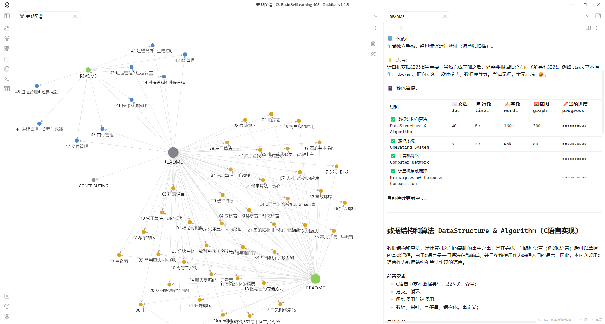

# CS-Basic-SelfLearning · 数据结构与操作系统自学笔记

本专栏面向已经掌握 C 语言基础、希望建立数据结构与操作系统知识框架的自学者。

项目始于 2022 年，保留了学习过程中的图解、代码片段与概念整理。

**当前收尾范围：数据结构与算法（C 语言）＋操作系统。** 目标是在明确范围内形成可阅读、可练习、可复查的学习路径。

> 本仓库仍处于整理阶段，尚不能视为完整教程。历史笔记主要参考王道课程，也包含其他资料；正文、插图和代码的来源正在逐项梳理。文章目录只区分“未完成”和“已完成”，按内容是否写齐维护；来源核查与错误修正继续逐篇处理。

## 从哪里开始

前置知识：C 语言的变量、分支与循环、函数、数组、指针和结构体。

1. [数据结构目录](【DSA】数据结构与算法（C语言版本）/README.md)：线性表 → 栈与队列 → 串 → 树 → 图 → 查找 → 排序。
2. [操作系统目录](【OS】操作系统/README.md)：运行机制 → 进程与同步 → 内存 → 文件 → I/O。
3. 每一主题尝试解释一个概念、手推一个例子，并检查实现或适用条件。学习目标、缺口与收尾标准见[项目收尾方案](PROJECT_PLAN.md)。

## 当前内容边界

| 模块 | 仓库现状 | 后续处理 |
| --- | --- | --- |
| 数据结构与算法 | 40 篇章节文件，包含正文、提纲和占位页 | 保留基础主线，优先补图与排序的关键缺口；进阶树与算法专题作为选读 |
| 操作系统 | 16 篇章节文件，其中设备与磁盘管理为空 | 保留进程、内存、文件、I/O 主线，补齐核心概念与自测 |
| 工具链 | CMake 学习材料 | 作为附录，不作为主线完成条件 |

文章代码片段与 `src` 示例的完整性、来源和运行状态需分别核查；目前不作“全部代码独立原创、全部编译通过”的统一承诺。资料说明见[来源与引用记录](SOURCES.md)。

---

# 数据结构和算法 DataStructure & Algorithm (C语言实现) 

数据结构和算法，是计算机入门的基础的重中之重，是在完成一门编程语言（例如C语言）后可以掌握的基础课程。由于C语言是一门语法稍微简单，并且多数使用作为编程入门的语言。因此，本内容采用C语言作为数据结构和算法实现的语言。

**前置需求**：
- C语言中基本数据类型、表达式、变量；
- 分支、循环；
- 函数调用与被调用；
- 数组、指针，字符串，结构体，重定义；
  
**具体章节**：见[数据结构与算法目录](【DSA】数据结构与算法（C语言版本）/README.md)。目录使用勾选标记“未完成 / 已完成”。

🔗课程链接：[数据结构_王道_哔哩哔哩_bilibili](https://www.bilibili.com/video/BV1b7411N798?p=2&vd_source=a7f0d42b9cbd9285a1aa3d740ec1b3af)
 
# 操作系统 Operating System
**操作系统是**控制管理计算机系统的硬软件，分配调度资源的**系统软件**，向上为上层软件提供接口，向下控制管理系统资源，是整个应用软件层和硬件层的中间过渡。操作系统课程分为四个部分：进程管理、内存管理、文件管理、I/O管理。
理解操作系统的功能和细节，常常需要将操作系统和现实世界联系起来，在这个课程中，我常常会摒弃掉一些无比复杂和专业性的词语、工整排比的特征分析，通过以现实世界的例子来理解，操作系统究竟干了哪些事情。

**具体章节**：见[操作系统目录](【OS】操作系统/README.md)。目录使用勾选标记“未完成 / 已完成”。

🔗课程链接：[操作系统_王道 哔哩哔哩_bilibili](https://www.bilibili.com/video/BV1YE411D7nH/?spm_id_from=333.337.search-card.all.click&vd_source=a7f0d42b9cbd9285a1aa3d740ec1b3af)

-------------------------------------------------------------------

同步发布：
[知乎：非科班CS之路](https://www.zhihu.com/column/c_1573830979768328192)

# 编辑工具
本文档采用[Obsidian](https://obsidian.md/)、VScode工具编写，可以较好进行文档编辑以及结构化展示等效果。

# 社群维护
本仓库致力于对计算机基础知识的总结和回顾，由本人在学习时总结，也同步期待其他学习者能够一并协助，共同归档维护。  
参考贡献文档：[CONTRIBUTING](CONTRIBUTING.md)
