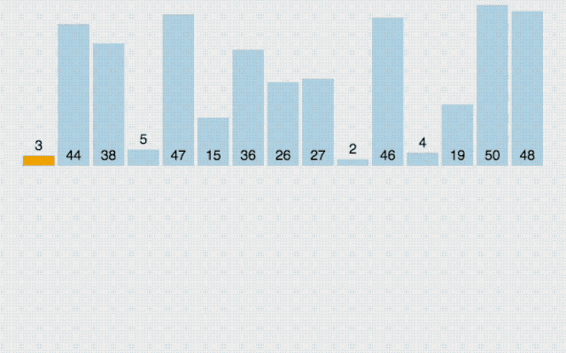

#数据结构 #算法 #C

# [84] 插入排序

插入排序像整理手里的扑克牌：已有的牌保持有序，每拿到一张新牌，就在其中找到位置，把它插进去。重复这个过程，直到所有元素都进入有序区间。

本篇依次介绍直接插入、带哨兵的插入、折半插入和单链表实现。数组按升序排列，代码采用 C11。



## 1. 从一趟插入理解算法

以 `5 2 4 2 1` 为例，用竖线分开有序区间与待处理区间：

| 步骤 | 待插入元素 | 结果 |
| --- | --- | --- |
| 初始 | — | 5 ｜ 2 4 2 1 |
| 第 1 趟 | 2 | 2 5 ｜ 4 2 1 |
| 第 2 趟 | 4 | 2 4 5 ｜ 2 1 |
| 第 3 趟 | 2 | 2 2 4 5 ｜ 1 |
| 第 4 趟 | 1 | 1 2 2 4 5 ｜ |

每趟先保存待插入的值，再把比它大的元素依次右移，最后填入空出来的位置。例如把第二个 2 插入 `2 4 5`：先右移 5 和 4，遇到已有的 2 就停止，把新 2 放在它后面。

**循环开始处理下标 i 时，[0, i) 已经有序；本趟结束后，[0, i+1) 有序。** 每处理一个新元素，有序区间就扩大一个位置。

下面使用迭代实现：循环重复“取值、查找、插入”，函数没有调用自身，因此不是递归。

## 2. 直接插入排序

实际元素存放在 `array[0..n-1]`。

以下图解使用另一组数据 `49 38 65 97 76 13 27 49`，依次展示各趟插入过程：


```c
void InsertSort(int array[], int n)
{
    for (int i = 1; i < n; ++i) {
        int key = array[i];
        int j = i;
        while (j > 0 && array[j - 1] > key) {
            array[j] = array[j - 1];
            --j;
        }
        array[j] = key;
    }
}
```

注意三个细节：

- 先保存 `key`，再右移元素，避免待插入值被覆盖。
- 条件先判断 `j > 0`。C 的逻辑与运算会短路，抵达数组左端时不会读取 `array[-1]`。
- 只移动严格大于 `key` 的元素，相等元素保留原顺序。

空数组和单元素数组不会进入循环。接口要求 n 非负，n 大于 0 时数组应包含至少 n 个可写元素。

## 3. 带哨兵的插入排序

这次改用另一种布局：**实际元素放在 array[1..n]，array[0] 只作暂存和哨兵。** 需要至少 n+1 个位置，不能直接把长度为 n 的普通数组传入此函数。

例如 `{0, 5, 2, 4, 2, 1}` 中，最前面的 0 不属于待排序数据，它的初值没有意义。


```c
void InsertSortSentinel(int array[], int n)
{
    for (int i = 2; i <= n; ++i) {
        if (array[i] < array[i - 1]) {
            array[0] = array[i];
            int j = i - 1;
            while (array[j] > array[0]) {
                array[j + 1] = array[j];
                --j;
            }
            array[j + 1] = array[0];
        }
    }
}
```

移动前把待插入值放进 `array[0]`。当 j 减到 0 时，比较变成 `array[0] > array[0]`，结果为假，循环自然停止。因此，内层循环不再需要单独检查左边界。

哨兵简化了边界判断，没有改变时间复杂度，也不能据此断言所有环境下都更快。示例保留“当前元素小于前驱”的判断，已有序时不执行右移。

## 4. 折半插入：减少查找时的比较

有序区间支持二分查找，所以可以先找到插入位置，再统一右移元素。这里恢复为 **0 起始下标**，与直接插入版本相同，不预留哨兵位置。

以下图解展示用折半查找确定插入位置的过程。图中实际数据从下标 1 开始，0 号位用于暂存，查找区间包含 low 和 high 两端；下方代码则采用 0 起始下标和左闭右开区间。理解过程时注意这两种下标约定的区别。


```c
void BinaryInsertSort(int array[], int n)
{
    for (int i = 1; i < n; ++i) {
        if (array[i] >= array[i - 1]) {
            continue;
        }
        int key = array[i];
        int low = 0, high = i;
        /* 在 [0, i) 中找第一个严格大于 key 的位置。 */
        while (low < high) {
            int mid = low + (high - low) / 2;
            if (array[mid] <= key) {
                low = mid + 1;
            } else {
                high = mid;
            }
        }
        /* [low, i) 整体右移，包括原来位于 low 的元素。 */
        for (int j = i; j > low; --j) {
            array[j] = array[j - 1];
        }
        array[low] = key;
    }
}
```

为了保持稳定性，寻找的是“第一个严格大于 key 的位置”。当 `array[mid] == key` 时继续向右找，新元素就会落在已有相同关键字之后。例如在 `2 2 4 5` 中插入新 2，应放到两个旧 2 后面。

搜索使用左闭右开的区间 [low, high)，初始为 [0, i)。循环结束时 low 就是插入位置；移动循环要覆盖原区间 [low, i)，不能漏掉位于 low 的元素。

**折半插入减少的是查找位置所需的关键字比较，最坏情况下并不减少元素移动。** 如果每个新元素都比已有元素小，仍须依次右移 1、2、……、n−1 个元素，总时间仍是 O(n²)。示例在二分查找前检查前驱，已经升序时直接跳过，保留 O(n) 的最好时间复杂度；不带这个检查的版本通常仍会逐趟执行二分查找。

## 5. 单链表上的插入排序

单链表不能按下标直接访问中间结点，不能照搬数组的二分查找来获得同样的查找开销。不过，把结点插入到已知前驱之后，只需修改链接，不需要搬移整段数据。

下面保留原结点，通过调整 next 指针排序。调用前链表应无环，返回值是排序后的新头指针，调用者必须接收它。代码需包含 `<stddef.h>`，以使用 NULL。

```c
struct ListNode {
    int val;
    struct ListNode *next;
};

struct ListNode *InsertionSortList(struct ListNode *head)
{
    if (head == NULL || head->next == NULL) {
        return head;
    }
    struct ListNode dummy = {0, head};
    struct ListNode *last = head;
    struct ListNode *cur = head->next;

    while (cur != NULL) {
        if (last->val <= cur->val) {
            last = cur;
        } else {
            struct ListNode *prev = &dummy;
            /* 插在已有相同值结点之后，保持稳定。 */
            while (prev->next != NULL && prev->next->val <= cur->val) {
                prev = prev->next;
            }
            last->next = cur->next;
            cur->next = prev->next;
            prev->next = cur;
        }
        cur = last->next;
    }
    return dummy.next;
}
```

- `dummy` 是临时头结点，统一处理插入到表头的情况；返回的是 `dummy.next`，不是临时结点的地址。
- `last` 指向有序部分的最后一个结点，`cur` 指向下一个待处理结点。
- 若 `last->val <= cur->val`，cur 已在正确位置，直接扩大有序部分。
- 否则，从表头找插入位置，先从原位置摘下 cur，再插到 prev 后面。此时 last 不移动，下一个待处理结点仍是 `last->next`。

查找时越过已有的相等值结点，再插入新结点，因此相等值结点保持原来的相对顺序。算法不分配、释放结点，也不交换结点中的数据。

## 6. 性能、稳定性与选择

下表针对本文的具体实现，平均情况按互异关键字的所有排列等概率出现分析；额外空间不计输入数组和原链表结点。

| 实现 | 最好时间 | 平均时间 | 最坏时间 | 额外空间 |
| --- | --- | --- | --- | --- |
| 直接插入 | O(n) | O(n²) | O(n²) | O(1) |
| 带哨兵的插入 | O(n) | O(n²) | O(n²) | O(1) |
| 折半插入（含前驱检查） | O(n) | O(n²) | O(n²) | O(1) |
| 单链表插入（含有序尾部检查） | O(n) | O(n²) | O(n²) | O(1) |

数组直接插入在严格逆序时，需要右移 n(n−1)/2 次；已经升序时，不需要右移元素。直接插入对较少的逆序较为友好，但数据规模增大且顺序杂乱时，二次量级的开销会成为限制。

本文四种实现都保持稳定。数组版本不把新元素插到已有相等元素前面；链表版本也让新结点排在已有相等结点之后。稳定性由这些具体条件保证，而不是由算法名称自动保证。

单链表版本的最坏输入也可能需要反复从表头扫描：例如一段较长的升序前缀之后，接上许多值相同、略小于该前缀末尾的结点。相反，严格逆序时，每个新结点都直接插入表头，这个链表实现只需 O(n) 时间。**同样的数据顺序，在数组和链表上可能产生不同开销。**

## 7. 编译与运行

完整程序见 [insert_sort.c](src/sort/insert_sort.c)，包含上述四种实现及调用示例。已安装 GCC 时，可在源文件所在目录运行：

```sh
gcc -std=c11 -Wall -Wextra -pedantic insert_sort.c -o insert_sort
./insert_sort
```

示例对同一组数分别使用四种实现，输出四行：

```text
1 2 2 4 5
1 2 2 4 5
1 2 2 4 5
1 2 2 4 5
```

可以先手推“把一个新 2 插入 2、4、5”，再对照代码检查：哪些元素需要移动，比较遇到相等时为何停止，以及插入后有序区间扩大到了哪里。

## 参考资料

- [NIST：insertion sort](https://xlinux.nist.gov/dads/HTML/insertionSort.html)：用于核对逐项有序插入，以及二分查找减少比较但仍需移动元素的说明。
- [王道数据结构课程](https://www.bilibili.com/video/BV1b7411N798)：历史学习笔记的课程参考。
