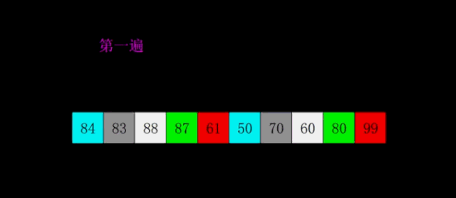

#数据结构 #算法 #C

# [85] 希尔排序（Shell Sort）

希尔排序也叫递减增量排序，由 Donald Shell 于 1959 年提出。它在直接插入排序的基础上，先让相距较远的元素有序，再逐步缩小间隔，最后完成整个序列的排序。

直接插入排序每次只向前移动一个位置。如果一个很小的数位于数组末尾，就需要经过多次移动才能到达前面。希尔排序先允许元素跨较大的步长移动，再用较小的步长细调位置；它的效率与增量序列的选择有关，不能笼统地认为所有输入都一定更快。

## 1. 算法思想

希尔排序先建立“间隔为 d 的有序关系”，再逐步缩小 d。


对于固定的增量 d，把下标相差 d 的元素视为同一组。例如 d = 4 时，下标 1、5、9 属于一组，下标 2、6、10 属于另一组。每组分别执行直接插入排序，但不需要真的拆成多个数组，只要按步长访问即可。

完成一轮后，每组内部有序，整个数组不一定有序。继续减小 d，直到 **d = 1**：此时所有元素属于同一组，执行的就是一次直接插入排序，因此可以保证最终结果有序。

## 2. 算法过程

沿用下图中的序列 `49 38 65 97 76 13 27 49`。实际数据从下标 1 开始，0 号位预留给暂存值。n = 8 时，取整折半的增量依次为 4、2、1。


可以对照图示核对每轮结果：

| 增量 d | 分组方式 | 本轮结束后的序列 |
| --- | --- | --- |
| 4 | 1、5 一组；2、6 一组；3、7 一组；4、8 一组 | 49 13 27 49 76 38 65 97 |
| 2 | 奇数下标一组，偶数下标一组 | 27 13 49 38 65 49 76 97 |
| 1 | 整个数组是一组 | 13 27 38 49 49 65 76 97 |

这里的 d **从 n/2 开始**，每轮用整数除法折半，最后一轮必须包含 1。第一轮不需要取 d = n，因为这时每组至多一个元素，不会产生排序效果。

## 3. C 语言实现

代码与原图保持相同的下标约定：实际元素位于 `array[1..n]`，调用者要分配至少 n+1 个位置，`array[0]` 不计入待排序元素。n 必须非负；n 小于 2 时直接返回。

```c
/* 实际元素位于 array[1..n]，array[0] 仅作暂存。 */
void shellSort(int array[], int n)
{
    if (n < 2) {
        return;
    }
    for (int d = n / 2; d >= 1; d /= 2) {
        for (int i = d + 1; i <= n; ++i) {
            if (array[i] < array[i - d]) {
                array[0] = array[i];
                int j = i - d;
                while (j > 0 && array[j] > array[0]) {
                    array[j + d] = array[j];
                    j -= d;
                }
                array[j + d] = array[0];
            }
        }
    }
}
```

固定 d 后，`i` 从 d+1 开始：每组的第一个元素已单独有序，从第二个元素起，向前按步长 d 查找插入位置。`j -= d` 让查找始终留在同一组，`array[j + d]` 则是为较大元素预留的后移位置。

**这里的 array[0] 是暂存单元，不是哨兵。** 因为 j 每次减 d，可能直接从正数变成负数，并不一定经过 0；必须先检查 `j > 0`，不能套用普通带哨兵插入排序的停止方式。C 的逻辑与运算会短路，边界条件不成立时，不会继续访问 `array[j]`。

动画演示：



观察时可以分别跟踪一个较小元素的位置，以及每轮组内是否有序；不要把“一组已经排好”误认为“整个数组已经排好”。

## 4. 算法性能与适用范围

### 时间和空间

本篇采用 `n/2、n/4、……、1` 的取整折半增量序列：

- **最好时间复杂度为 O(n log n)**：已经有序时，每轮不需要移动元素，但仍要检查各组；共有 O(log n) 轮，每轮做 O(n) 量级的检查。
- **最坏时间复杂度为 O(n²)**。这一结论针对本篇的折半序列，不能直接套用到所有增量序列上；相关分析见[希尔排序课程讲义](https://www.cs.hunter.cuny.edu/~sweiss/course_materials/csci335/lecture_notes/chapter07.pdf)。
- 平均开销与增量序列、输入分布有关，本篇不为所有希尔排序给出一个统一的平均复杂度公式。
- **额外空间复杂度为 O(1)**：只使用若干循环变量和一个暂存位置，没有递归调用栈或额外数组。

不能把“复杂度与增量有关”写成“希尔排序的复杂度无法证明”。具体序列可以有具体分析；更换增量序列后，需要重新核对相应结论。

### 为什么不稳定

即使每组的插入过程只移动严格更大的元素，不同组之间的长距离移动也可能改变相等关键字的相对次序。

例如用 A、B 区分两个值为 2 的记录：`2A 2B 1 3`。d = 2 时，下标 1、3 的一组变成 `1 2A`，整个序列成为 `1 2B 2A 3`。最后 d = 1 的稳定插入不会再交换 2A、2B，它们的相对顺序已经改变。因此，希尔排序是**不稳定排序**。

### 何时考虑它

希尔排序可以在常数额外空间下完成排序，代码也较简短；但它不适合要求保留相等关键字顺序的场景，性能分析还必须结合增量选择。它依赖按步长访问元素，通常用于数组等支持随机访问的顺序存储结构；普通链表无法直接获得同样的访问效率。

## 5. 编译与运行

完整程序见 [shell_sort.c](src/sort/shell_sort.c)。程序中的初始数组为 `{0, 49, 38, 65, 97, 76, 13, 27, 49}`，首个 0 只占暂存位置。已安装 GCC 时，可在源文件目录中运行：

```sh
gcc -std=c11 -Wall -Wextra -pedantic shell_sort.c -o shell_sort
./shell_sort
```

输出：

```text
13 27 38 49 49 65 76 97
```

## 参考资料

- [NIST：Shell sort](https://xlinux.nist.gov/dads/HTML/shellsort.html)：增量递减、组内插入及增量序列对效率的影响。
- [Stewart Weiss：Sorting 课程讲义](https://www.cs.hunter.cuny.edu/~sweiss/course_materials/csci335/lecture_notes/chapter07.pdf)：原始折半增量序列的最坏情况分析。
- [王道数据结构课程](https://www.bilibili.com/video/BV1b7411N798)：历史学习笔记的课程参考。
