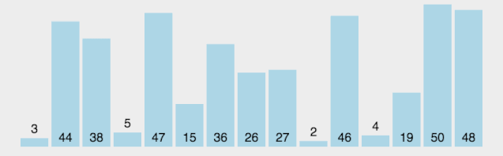

#数据结构 #算法 #C

# [86] 快速排序

快速排序（Quicksort）由 Tony Hoare 提出，是一种使用分治策略的排序方法：先选一个枢轴，把数据划分到它的两侧，再分别处理两边的子区间。

## 1. 算法思想

一次递归调用处理一个待排区间，完成三步：

1. 选择一个元素作为枢轴（pivot），本篇使用区间首元素。
2. 进行一次划分（partition），把枢轴放到最终位置，并让左右两边满足大小关系。
3. 分别递归处理枢轴左右两侧，空区间或单元素区间直接结束。



本篇使用 0 起始下标和闭区间 `[low, high]`。若划分返回下标 k，则结果满足：

$$array[low..k-1] \le pivot,\qquad array[k+1..high] \ge pivot$$

也就是左边元素都不大于枢轴，右边元素都不小于枢轴。**等于枢轴的元素可能出现在任意一侧**，不能把下面的实现描述成“左边严格小于、右边大于等于”。

这里的划分仅确定了枢轴的位置，并没有把两侧各自排好；两侧仍要继续排序。后续递归范围是 `[low, k-1]` 和 `[k+1, high]`，不能再次包含已经归位的枢轴。

## 2. 算法过程

沿用数组 `{49,38,65,97,76,13,27,49}`。第一次以 `array[0]` 的 49 为枢轴，使用左右两个下标寻找它的最终位置。


上面的过程可以理解为“保存枢轴，再交替填空”：

1. 保存首元素 49，把它原来的位置视为一个空位。
2. 从右向左找小于 49 的元素，将它填到左侧空位。第一次找到的是 27。
3. 从左向右找大于 49 的元素，将它填到右侧空位。第一次找到的是 65。
4. 继续交替寻找、填入，直到 low 与 high 相遇，把保存的 49 放回相遇位置。

这里的“空位”是帮助理解赋值过程的概念，不表示程序真的删除了某个数组元素。因为枢轴已保存在局部变量中，交替覆盖仍能保留原来的所有值。

第一次划分后得到 `27 38 13 49 76 97 65 49`，枢轴位于下标 3。接下来先处理左子区间 `[0, 2]`：


左子区间处理完后，原调用再处理右子区间 `[4, 7]`：


最终得到 `13 27 38 49 49 65 76 97`。先处理左边还是右边不影响最终升序结果，下面的实现先递归左边。

## 3. C 语言实现

```c
/* 划分非空闭区间 [low, high]，返回枢轴的最终下标。 */
int Partition(int array[], int low, int high)
{
    int pivot = array[low];

    while (low < high) {
        while (low < high && array[high] >= pivot) {
            --high;
        }
        array[low] = array[high];

        while (low < high && array[low] <= pivot) {
            ++low;
        }
        array[high] = array[low];
    }
    array[low] = pivot;
    return low;
}

void QuickSort(int array[], int low, int high)
{
    if (low < high) {
        int pivotPos = Partition(array, low, high);
        QuickSort(array, low, pivotPos - 1);
        QuickSort(array, pivotPos + 1, high);
    }
}
```

`Partition` 只用于有效的非空区间。`QuickSort` 通过 `low < high` 确保只有至少两个元素时才调用划分；空数组可用 `QuickSort(array, 0, -1)` 表示，不会读取数组。

在 `Partition` 中，两次内层循环都先检查 `low < high`，防止扫描越过相遇点。右侧扫描跳过大于等于枢轴的元素，左侧扫描跳过小于等于枢轴的元素；即使有重复值，扫描也会推进到相遇位置，不会因相等而停在原地反复处理。

### 对照递归调用图

下面保留原有调用栈图。图中的行号对应早期代码排版，阅读时以函数名和区间为准：`pivot` 是保存的枢轴值，代码中的 `pivotPos` 是 `Partition` 返回的下标，二者不要混淆。

初始调用 `QuickSort(array, 0, 7)`，先执行 `Partition(array, 0, 7)`：


当 low 与 high 相遇时，把保存的枢轴写回，第一次划分返回 3。原调用继续执行 `QuickSort(array, 0, 2)`：


左子区间以 27 为枢轴，划分后确定其位置，再处理更小的区间；区间至多有一个元素时直接返回：


左侧递归返回后，再从先前保留的调用现场继续处理右侧区间。调用栈保存的是每次调用的参数和局部状态，不是多份完整数组；各层处理的是同一个数组中的不同区间。


## 4. 时间与空间开销

可以把递归过程看成一棵树：一个结点代表一次区间划分，两个子结点分别代表左右子区间。树的高度影响递归栈的深度。


长度为 m 的区间，单次划分需要 O(m) 时间。递归树同一层处理的区间互不重叠，这一层的总划分开销至多为 O(n)。

- **划分较均衡**：递归深度为 O(log n)，总时间为 O(n log n)。
- **划分极不均衡**：每次只有一侧含有剩余的 n−1 个元素，需要 O(n) 层，总开销为 `(n−1)+(n−2)+…+1`，即 O(n²)。

| 情况 | 时间复杂度 | 递归栈额外空间 |
| --- | --- | --- |
| 最好情况，划分较均衡 | O(n log n) | O(log n) |
| 平均情况，互异关键字的所有排列等概率出现 | O(n log n) | O(log n)，按期望计 |
| 最坏情况，划分持续极不均衡 | O(n²) | O(n) |

上述空间分析针对本篇直接递归两侧的实现。单次划分本身只用常数额外空间，但不能因此忽略递归调用栈，把整个程序的额外空间写成 O(1)。平均情况的结论也不是对任意输入的保证。

### 哪些输入会退化

本篇固定选择区间首元素作为枢轴。已经升序、严格逆序，以及所有元素相等的输入，都会让这种划分方式反复产生一侧为空的子区间，从而退化到 O(n²)，同时增加递归深度。

因此，这个版本适合说明划分与递归过程；面对大规模、可能出现上述分布的数据，需要考虑改进，避免二次时间和过深调用栈。

### 可考虑的优化

- 随机选择枢轴并与区间首元素交换，再调用同一划分过程，可降低固定输入顺序持续造成坏划分的风险；对互异关键字可获得期望 O(n log n) 时间，仍不保证每次运行都如此。
- 三数取中比较首、中、尾三个候选值，选取中间值作为枢轴，通常比固定选首元素更不容易受到已有序输入的影响，但仍有最坏情况。
- 重复值很多时，三路划分把小于、等于、大于枢轴的元素分开，只递归两侧，可避免反复处理大段相等元素。单纯随机选枢轴不能解决本篇实现对全相等输入的退化。
- 递归较小的一侧、用循环处理较大的一侧，可以把栈深度限制在 O(log n)；它改善空间使用，不会自动消除 O(n²) 的最坏时间。

这些是可扩展方向，未加入下方的基础示例。快速排序的实际表现取决于枢轴选择、划分方式、数据分布和实现细节，不宜笼统称为“所有内部排序中平均性能最优”。

## 5. 稳定性

本篇快速排序是不稳定的。即使比较时跳过相等值，长距离搬移仍可能改变相等记录的相对次序。

例如用 A、B 区分两个值为 2 的记录：`2A 2B 1`。第一次以 2A 为枢轴，最终得到 `1 2B 2A`，两条记录的相对次序已经颠倒。


如果业务要求保留相同关键字记录的原顺序，就不能直接依赖这个实现的排序结果。

## 6. 编译与运行

完整程序见 [quick_sort.c](src/sort/quick_sort.c)，其中 n 采用有符号的 int 保存，调用范围为 `[0, n-1]`。非空区间必须位于数组的有效范围内。已安装 GCC 时，可在源文件目录运行：

```sh
gcc -std=c11 -Wall -Wextra -pedantic quick_sort.c -o quick_sort
./quick_sort
```

输出：

```text
13 27 38 49 49 65 76 97
```

## 参考资料

- [NIST：quicksort](https://xlinux.nist.gov/dads/HTML/quicksort.html)：枢轴划分与递归、常见变体以及通常和最坏情况下的时间开销。
- [王道数据结构课程](https://www.bilibili.com/video/BV1b7411N798)：历史学习笔记的课程参考。
