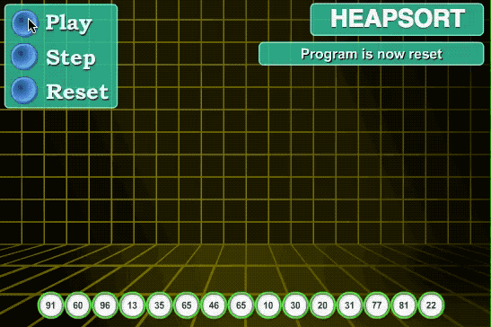

#数据结构 #算法 #C

# [89] 堆排序

堆排序也属于选择排序：每轮从剩余元素中选出一个最大值，放到数组末尾。与每次都从头扫描的简单选择排序不同，它利用堆结构维护最大值的位置，取出堆顶后只需局部调整。

## 1. 堆（heap）

二叉堆可以看成一棵满足大小关系的**完全二叉树**。把它按层次存入数组，并让实际元素从下标 1 开始，则结点 k 的双亲下标为 `k/2`（取整），左、右孩子下标分别为 `2*k`、`2*k+1`。

在孩子确实存在的前提下：

- **大根堆（大顶堆）**：每个父结点的值不小于孩子，根结点是整个堆的最大值。
- **小根堆（小顶堆）**：每个父结点的值不大于孩子，根结点是整个堆的最小值。


注意，堆只约束父子关系，左右兄弟之间不要求有序；一个合法的堆通常也不是一个已经排好的数组。不能把二叉堆与二叉搜索树的“左小右大”关系混为一谈。

当 n 为偶数时，最后一个非叶结点 `n/2` 只有左孩子。例如 n = 4 时，下标 2 的左孩子为 4，右孩子 5 不存在。这是下沉实现必须覆盖的边界。

## 2. 算法思想与过程

升序排序使用大根堆，每轮把当前最大值移到剩余区间末尾：

1. 从最后一个非叶结点开始，向前逐个下沉，建立大根堆。
2. 交换堆顶与当前堆尾。原堆顶进入右侧的有序区间，不再参与调整。
3. 缩小堆的范围，把新的堆顶向下调整，恢复大根堆。
4. 重复，直到堆中只剩一个元素。



例如对 `4 1 3 2` 排序，先建立大根堆 `4 2 3 1`。用竖线区分左侧的堆与右侧已经确定的结果：

| 步骤 | 操作后的数组 |
| --- | --- |
| 建堆完成 | 4 2 3 1 ｜ |
| 4 与堆尾交换，剩余三个元素重新下沉 | 3 2 1 ｜ 4 |
| 3 与堆尾交换，剩余两个元素重新下沉 | 2 1 ｜ 3 4 |
| 2 与堆尾交换 | 1 ｜ 2 3 4 |

**下沉时总要选较大的孩子。** 否则父结点即使不小于一个孩子，也可能仍然小于另一个孩子，不能恢复大根堆。若父结点已不小于较大的孩子，就可以提前停止。

## 3. C 语言实现

代码沿用图中的 1 起始下标，实际元素在 `array[1..n]`，调用者需分配至少 n+1 个位置。`array[0]` 不使用；n 必须非负。

```c
/* 两个孩子子树已是大根堆时，调整以 k 为根的子树。 */
void HeapAdjust(int array[], int k, int n)
{
    int value = array[k];
    while (k <= n / 2) {
        int child = 2 * k;
        if (child < n && array[child] < array[child + 1]) {
            ++child;
        }
        if (value >= array[child]) {
            break;
        }
        array[k] = array[child];
        k = child;
    }
    array[k] = value;
}

void BuildMaxHeap(int array[], int n)
{
    for (int k = n / 2; k >= 1; --k) {
        HeapAdjust(array, k, n);
    }
}

/* 实际元素位于 array[1..n]，array[0] 不参与排序。 */
void HeapSort(int array[], int n)
{
    if (n < 2) {
        return;
    }
    BuildMaxHeap(array, n);
    for (int end = n; end > 1; --end) {
        int temp = array[1];
        array[1] = array[end];
        array[end] = temp;
        HeapAdjust(array, 1, end - 1);
    }
}
```

### 下沉的两个边界

`k <= n/2` 表示当前结点至少有左孩子，所以 `child = 2*k` 一定在堆内。只有在 `child < n` 时，右孩子 `child+1` 才存在。

例如堆中剩下两个元素 `1 2` 时，根的左孩子恰好位于下标 n。若用 `child < n` 作为整个下沉循环的条件，就会跳过这个孩子，错误地把 `1 2` 当成大根堆。

循环先检查 `k <= n/2`，再计算 `2*k`，也避免了在叶结点处无意义地计算孩子下标。每次把较大孩子提升到父结点的位置，最后把保存的 value 填回空出来的位置。

### 为什么从后向前建堆

直接调用 `HeapAdjust` 时，应保证 `1 <= k <= n`。叶结点单独就是合法的堆。按 `n/2、n/2−1、……、1` 的顺序调整时，每个结点的孩子子树都已经处理完，恰好满足 `HeapAdjust` 的前提。不能把它当成“任意修改之后都能从任意结点一次恢复整个堆”的通用函数。

## 4. 算法性能与稳定性

- **单次下沉**最多经过树高数量的结点，最坏时间为 O(log n)。
- **自底向上建堆为 O(n)**，不是每个结点都需要走满树高：约一半结点是叶子，不需要下沉；越靠近根、可能下沉越远的结点，数量越少。把各层工作量相加，仍是线性量级。
- **排序阶段**最多进行 n−1 次取堆顶和下沉，最坏时间为 O(n log n)，整体最坏时间也是 O(n log n)。互异关键字随机排列时，平均时间为 O(n log n)。
- **额外空间为 O(1)**：本篇采用循环下沉，没有递归调用栈，也不需要另建一个数组保存堆。

最好时间要结合具体实现判断。本篇下沉会在父结点已满足条件时停止；若所有元素相等，建堆和每轮调整都很快结束，整体可以达到 O(n)。不能仅凭“每次下沉最坏 O(log n)”就断言所有输入都必须花 O(n log n)。

堆排序**不稳定**。例如用 A、B 区分两个值为 2 的记录，输入 `2A 1 2B` 本来就是大根堆。把堆顶与堆尾交换后，2A 被放到最后，最终结果为 `1 2B 2A`，相同关键字的相对次序改变了。

堆排序适合需要常数额外空间和 O(n log n) 最坏时间保证的场景；如果要求稳定性，则不能直接使用这个实现。

# [90] 堆的插入与删除

以下用**小根堆**说明，与前面大根堆的比较方向相反。每次操作都要保持完全二叉树的形状，再恢复父子大小关系。

## 1. 插入：先放到末尾，再上浮

新结点先占据数组末尾的新位置，与双亲比较。如果比双亲小，就交换并继续向上，直到到达根或不再违反小根堆关系。

例如在 `2 5 3 9 7` 中插入 1：

```text
2 5 3 9 7 1
2 5 1 9 7 3
1 5 2 9 7 3
```

在已有足够容量的前提下，上浮的最坏时间为 O(log n)。数组扩容的开销需要另外计算。

## 2. 删除堆顶：用末尾补位，再下沉

取出根结点后，把最后一个元素移到根，缩小堆的范围，再与较小的孩子比较、向下调整。

例如删除小根堆 `2 5 3 9 7` 的堆顶 2：末尾 7 补到根后成为 `7 5 3 9`，再下沉得到 `3 5 7 9`。最坏时间为 O(log n)。

如果删除的是**任意位置**，末尾元素补位后可能需要上浮，也可能需要下沉。应先检查它与双亲的关系；不能把“删除堆顶后下沉”直接套用到所有删除操作。若尚不知道待删元素的下标，查找它还可能需要 O(n) 时间。

## 编译与运行

完整程序见 [heap_sort.c](src/sort/heap_sort.c)。已安装 GCC 时，可在源文件目录运行：

```sh
gcc -std=c11 -Wall -Wextra -pedantic heap_sort.c -o heap_sort
./heap_sort
```

示例中最前面的 0 只占位，不参与排序。输出：

```text
1 9 17 32 45 53 65 87
```

## 参考资料

- [NIST：heap](https://xlinux.nist.gov/dads/HTML/heap.html)：堆的完全树结构与父子大小关系。
- [NIST：heapsort](https://xlinux.nist.gov/dads/HTML/heapSort.html)：建堆、反复取最大值与整体时间上界。
- [王道数据结构课程](https://www.bilibili.com/video/BV1b7411N798)：历史学习笔记的课程参考。
